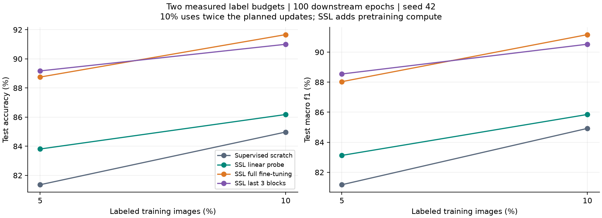
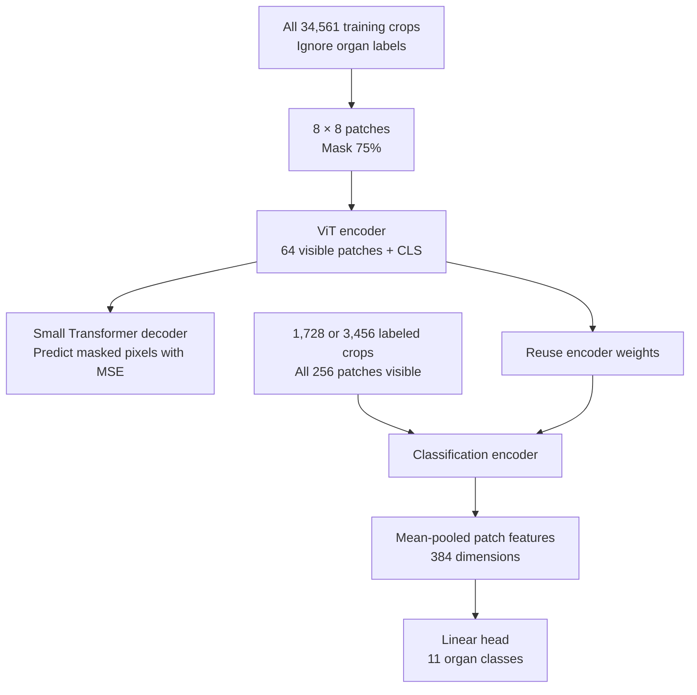
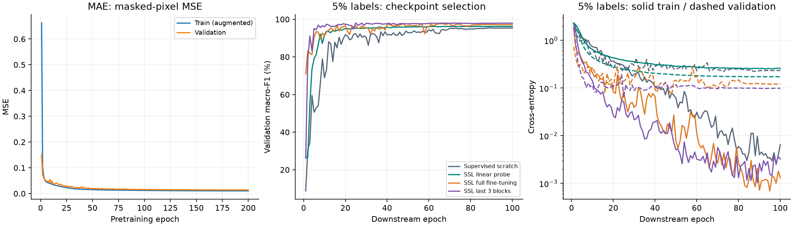

# CT-MAE

[](https://github.com/Lawliet-HSGSM/ct-mae/actions/workflows/ci.yml)

**Label-efficient organ classification on abdominal CT crops with masked autoencoders.**

This project asks whether self-supervised pretraining helps when only a small
fraction of training images have usable classification labels. A compact Vision
Transformer learns to reconstruct masked OrganAMNIST crops, then transfers to
11-class organ classification through linear probing, partial or full fine-tuning.

With **1,728 labeled training images (about 5%)**, MAE full fine-tuning reached
**88.75% test accuracy**, versus **81.36%** for the same classifier trained from
random initialization. These are measured results from **one seed**, with additional
unlabeled training data and pretraining compute available to the SSL methods.



## Results

Each classifier trains for 100 epochs. Checkpoints maximize validation macro-F1;
test metrics are computed afterward on all 17,778 official test images.

| Method | Trainable parameters | 5% accuracy | 5% macro-F1 | 10% accuracy | 10% macro-F1 |
| --- | ---: | ---: | ---: | ---: | ---: |
| Supervised from scratch | 21.32M | 81.36% | 81.17% | 84.98% | 84.92% |
| SSL linear probing | 4,235 | 83.81% | 83.13% | 86.18% | 85.85% |
| SSL full fine-tuning | 21.32M | 88.75% | 88.04% | 91.66% | 91.17% |
| SSL partial: last 3 blocks | 5.33M | 89.17% | 88.55% | 91.00% | 90.53% |

The 10% subset contains the entire 5% subset. Equal epochs give 10% twice the
planned downstream optimizer updates, so this table does not isolate label count
from optimization budget. All SSL classifiers reuse the same MAE checkpoint;
scratch receives no pretraining.

Follow-up experiments also compare confusion-aware batches, class-weighted
cross-entropy and supervised contrastive learning. At **1,350 continuation updates**,
the validation-selected full/CE variant improves from **89.09% accuracy at 5%** to
**90.87% at 10%**. SupCon reaches a higher test score in one variant, but does not
replace the variant selected by validation.

See [findings and limitations](docs/RESULTS.md), [all 28 runs as CSV](docs/results/metrics.csv),
and the [audited result snapshot](docs/results/results.json).

## Method



| Component | Configuration |
| --- | --- |
| Input | Grayscale `float32`, `[B, 1, 128, 128]`, pixels divided by 255 |
| Patches | `8 × 8`; 256 patches/image; 64 visible during pretraining |
| Encoder | 12 Transformer blocks, width 384, 6 attention heads |
| Decoder | 2 blocks, width 128, 4 heads; linear pixel prediction |
| Position encoding | Fixed 2D sine–cosine; MLP ratio 4 |
| Pretext objective | MSE on masked patches only; no pixel-target normalization |
| Classification | Mean of all patch tokens → `Linear(384, 11)`; cross-entropy |
| Augmentation | Rotation ±5°, translation ≤5%, bilinear interpolation, zero fill |
| Initialization | Random weights with MAE-style initialization; no ImageNet weights |

Linear probing freezes the entire encoder in evaluation mode. Partial fine-tuning
trains the last 3 blocks, final LayerNorm and classifier. Full fine-tuning trains
the entire encoder and classifier. Fixed position embeddings remain fixed throughout.

Pretraining runs 200 epochs with AdamW, peak LR `1.5e-4`, effective batch 256,
10-epoch warmup and cosine decay. Downstream effective batch is 64, with peak LR
`3e-4` for scratch/full/partial and `1e-3` for the linear probe. The
[configuration](src/ct_mae/baseline.json) and [protocol](docs/experiments/baseline.md)
record the remaining settings. This is a smaller adaptation of MAE, not a reproduction
of its original ImageNet training setup.



## Data and evaluation

The official **OrganAMNIST128** release contains 34,561 train, 6,491 validation and
17,778 test grayscale crops across 11 classes. It provides organ labels for every
split; labels outside the chosen training subset are ignored during supervised training.
All training images contribute to MAE pretraining. Validation/test images do not.

The label budgets refer to **training labels only**. All validation labels remain
available for checkpoint selection and later experiment design. Subsets are
stratified, deterministic and published as [5% indices](docs/results/subset_1728.json)
and [10% indices](docs/results/subset_3456.json).

Official splits are preserved. The source dataset uses different CT scans across
the splits; the NPZ release does not include per-image scan/patient IDs. Thousands
of crops therefore cannot be treated as thousands of independent patients.
The 128px images come from the official MedMNIST+ release, not upsampled 28px inputs.
See the [official metadata](https://github.com/MedMNIST/MedMNIST/blob/main/medmnist/info.py)
and [generation notes](https://github.com/MedMNIST/MedMNIST/blob/main/on_medmnist_plus.md).

The analysis covers per-organ precision/recall/F1, confusion matrices, paired
corrected/new errors, train-fitted PCA/SVD, and the validation–test gap. It does
not establish blur, crop quality or anatomical texture as the cause of an error.
Test examples were inspected before later studies, so follow-up findings are
**exploratory**, not an untouched confirmatory evaluation. No clinical validation
was performed.

## Quick start

Run these commands from the repository root with **Python 3.12** and
[uv](https://docs.astral.sh/uv/). Data exploration needs no GPU or W&B account.

```powershell
git clone https://github.com/Lawliet-HSGSM/ct-mae.git
cd ct-mae
uv sync --locked --group dev
uv run python -m ct_mae.download --data-dir data --sizes 128
uv run python -m ct_mae.explore --data-dir data --sizes 128 --output reports/exploration
```

Open `reports/exploration/explorer.html` in a browser. The download is about 708 MB;
the loader verifies the official MD5 and reuses a valid local copy. Larger local
storage is needed for unpacked arrays, checkpoints and experiment outputs.

For CPU checks and input preparation:

```powershell
uv sync --locked --extra train --group dev
uv run --extra train pytest -q
uv run --extra train ruff check .
uv run --extra train python -m ct_mae.run --stage prepare --device cpu --wandb-mode disabled --data-dir data --output reports/local-check
```

Preparation writes input previews, the labeled subset and model parameter counts
without training. Windows uses CPU PyTorch through the configured uv index. The
completed training experiments used one Kaggle Tesla T4 with FP16 AMP. Smoke mode
keeps the full architecture while shortening epochs and data; a GPU is recommended.

For the full workflow, GPU setup, checkpoint reuse and offline reports, follow
[reproduction instructions](docs/REPRODUCING.md). To redraw the public charts
using only the committed result snapshot:

```powershell
uv run python scripts/publish_results.py
```

## Repository layout

```text
src/ct_mae/             Models, data, training, checkpointing, analysis and reports
tests/                 Data/model/loss, accumulation, freezing and resume checks
scripts/               Report browser checks and public-result export
docs/RESULTS.md         Findings, comparisons and interpretation limits
docs/REPRODUCING.md     Commands and expected artifact layout
docs/experiments/      Detailed protocols and experiment records
docs/results/          Scalar histories, metrics, provenance hashes and train indices
docs/assets/           Figures from completed runs
```

Raw data, model weights, W&B logs, signed download manifests and large generated
HTML reports stay outside Git. **Trained checkpoints are not distributed in this
repository**; inference from the reported models requires the original artifacts
or retraining. The committed snapshots allow inspection and chart reproduction,
not independent rerunning of model inference.

## References and attribution

- He et al., **Masked Autoencoders Are Scalable Vision Learners**, CVPR 2022.
  [Paper](https://arxiv.org/abs/2111.06377) · [Reference code](https://github.com/facebookresearch/mae)
- Khosla et al., **Supervised Contrastive Learning**, NeurIPS 2020.
  [Paper](https://arxiv.org/abs/2004.11362) · [Reference code](https://github.com/HobbitLong/SupContrast)
- Yang et al., **MedMNIST v2**, Scientific Data 2023.
  [Paper](https://doi.org/10.1038/s41597-022-01721-8) · [Dataset](https://zenodo.org/records/10519652)
- Bilic et al., **The Liver Tumor Segmentation Benchmark (LiTS)**, Medical Image Analysis 2023.
  [Paper](https://doi.org/10.1016/j.media.2022.102680)

MAE architecture, masking and initialization follow the reference implementation;
the grayscale model size, training budget and downstream studies are project
adaptations. Loss, data, training, auditing and reporting code are implemented here.
See [third-party notices](THIRD_PARTY_NOTICES.md) and [BibTeX references](docs/references.bib).

Project code and original project material use [CC BY-NC 4.0](LICENSE), with
upstream notices retained. OrganAMNIST images and their reproductions retain the
dataset's **CC BY 4.0** attribution; they are not relicensed under the code license.
