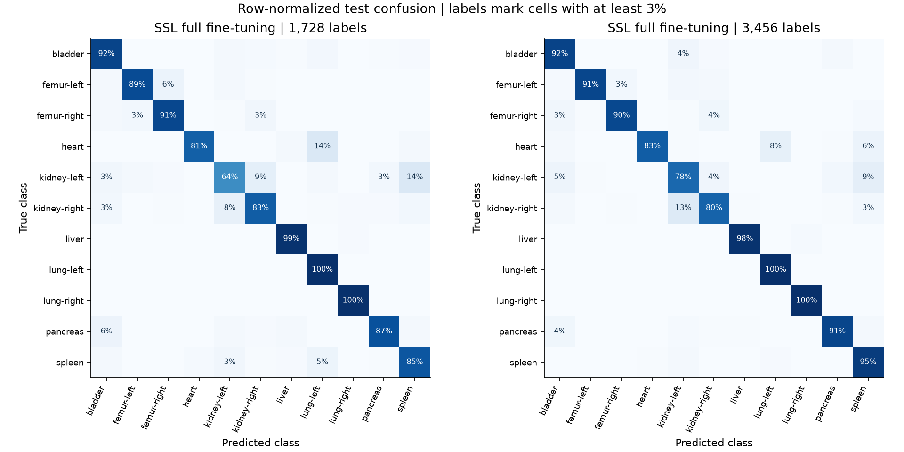
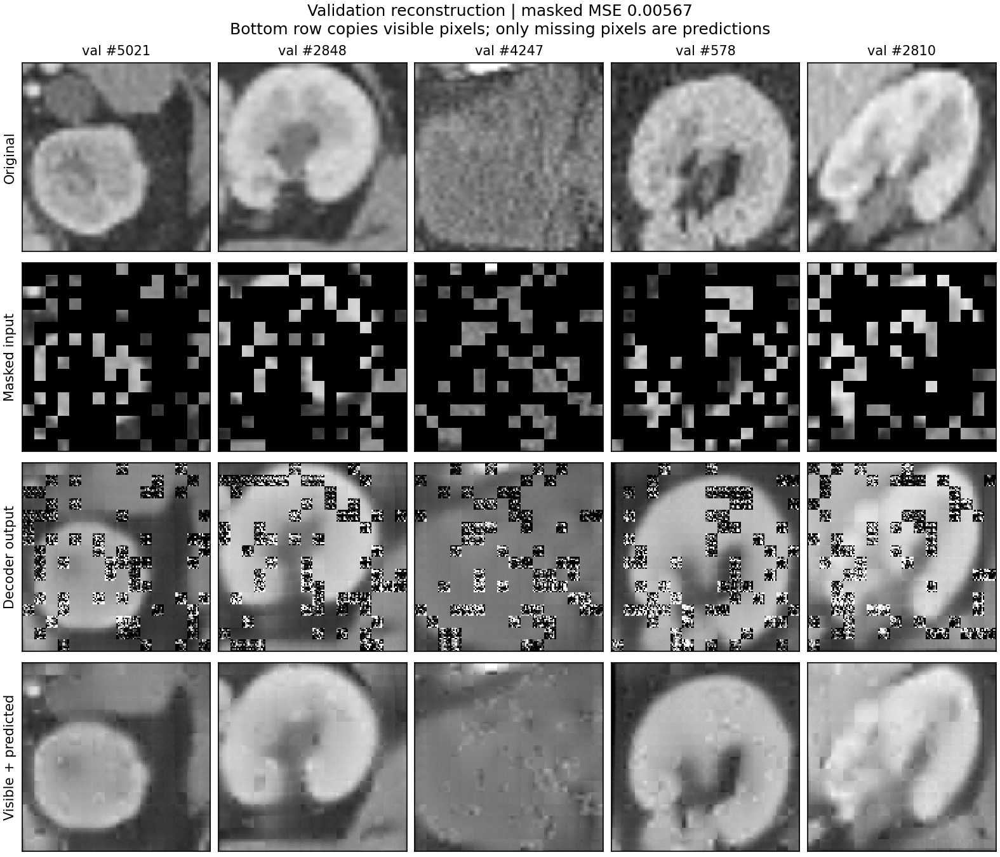
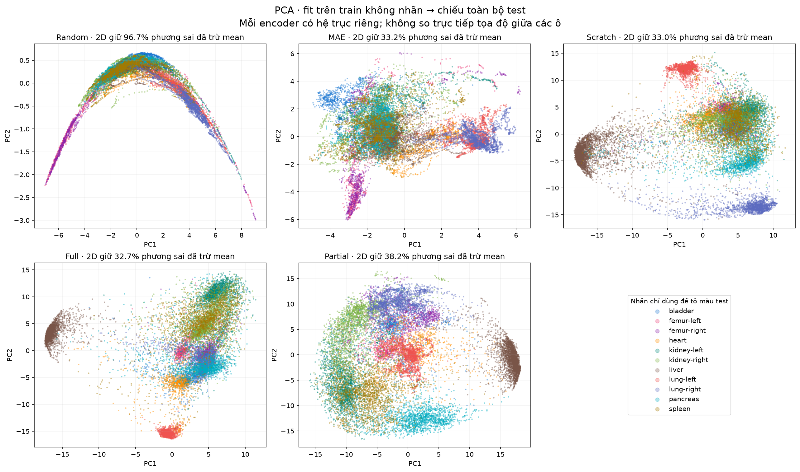
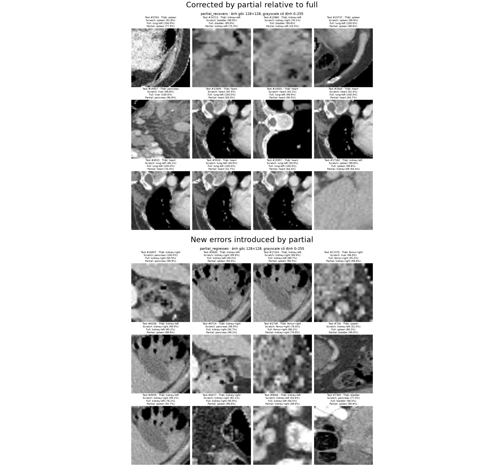
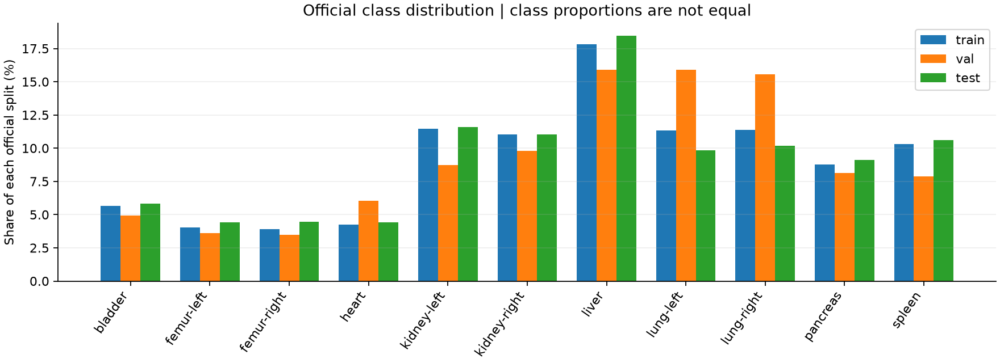

# Findings from the completed CT-MAE experiments

All values come from completed seed-42 runs on the official OrganAMNIST128 splits.
Tables use percentages; changes are percentage points. The [CSV](results/metrics.csv)
contains all 28 classifier runs. [results.json](results/results.json) includes
per-class metrics, integer confusion counts, scalar histories, settings and
artifact hashes. Metrics were recomputed from aligned test predictions before export.

## 1. Does MAE help at a small label budget?

The supervised control is the same ViT encoder plus classifier, initialized
randomly and trained only with the selected organ labels. SSL methods first see
all 34,561 training images without their organ labels, then use the same labeled
subset as the control. This measures the usefulness of extra unlabeled data
through pretraining; it does not match total data exposure or total compute.

| Method | 5% accuracy | 5% macro-F1 | 10% accuracy | 10% macro-F1 |
| --- | ---: | ---: | ---: | ---: |
| Scratch | 81.36 | 81.17 | 84.98 | 84.92 |
| Linear probe | 83.81 | 83.13 | 86.18 | 85.85 |
| Full fine-tuning | 88.75 | 88.04 | 91.66 | 91.17 |
| Last 3 blocks | 89.17 | 88.55 | 91.00 | 90.53 |

Full exceeds scratch by **7.39 points at 5%** and **6.69 points at 10%**. Full at
5% also exceeds scratch at 10%. These are label-budget observations, not a claim
that SSL is cheaper after adding the 200-epoch pretraining stage.

The subset grows from 1,728 to 3,456 through a stratified extension without
replacement. At 100 epochs, the larger subset gives 5,400 planned updates instead
of 2,700; the 5% full run has 2,699 successful updates after one FP16 scaler skip.
Equal epochs mix the effects of more distinct labeled images and more updates.

## 2. Should all encoder blocks be trainable?

At 5%, last-3-block tuning is slightly ahead of full fine-tuning, while training
5.33M instead of 21.32M parameters. Measured T4 peak training VRAM is about
0.55 GiB versus 1.73 GiB, and training-loop time is 6.4 versus 11.7 minutes.
Complete stages, including evaluation/checkpoint work, take 22.5 versus 25.5 minutes.
The shared pretraining cost is excluded from these times.

At 10%, full fine-tuning overtakes partial. One seed and two label budgets do not
establish a universally best number of unfrozen blocks. Partial is a measured
memory/accuracy trade-off, rather than a general rule about same-domain adaptation.

Rows are true organs and columns are predicted organs. The diagonal gives recall
for each organ. Aggregate improvement can coexist with a worse specific direction:
right-kidney → left-kidney increases from 161 to 256 errors at 10% in the initial
full model, although its overall accuracy improves.

## 3. What happens when continuing the existing classifiers?

This is a separate study. Every branch starts from the corresponding **5%-label
MAE-derived classifier**, retaining its trained head. Ten candidates per label
budget combine two source families (full/partial) with five variants:

| Variant | Change |
| --- | --- |
| A | Shuffled batches, cross-entropy (CE) continuation control |
| B | Confusion-pair batches + CE |
| C | B + fixed class-weighted CE |
| D | B + CE + supervised contrastive loss (SupCon) |
| E | B + weighted CE + SupCon |

Hard-pair priorities and weights come from **source validation**, not test.
B–E rearrange batches without oversampling: each selected base image appears
once per epoch. Every variant uses two mild affine views per base image.
SupCon's projection head is used only in training; the contrastive pool is the
physical microbatch, not the gradient-accumulation group.

The source model is candidate epoch 0. Checkpoints and variants are selected by
validation macro-F1 within each source family, retaining the earlier checkpoint
on ties. The study does not predeclare one global winner across both families.

### Same 1,350 continuation updates, two label budgets

| Source / selected candidate | Train labels | Epochs run | Selected epoch | Val macro-F1 | Test accuracy | Test macro-F1 |
| --- | ---: | ---: | ---: | ---: | ---: | ---: |
| Full / source | 1,728 | — | 0 | 97.77 | 88.75 | 88.04 |
| Full / A | 1,728 | 50 | 13 | 97.88 | 89.09 | 88.68 |
| Full / A | 3,456 | 25 | 6 | 98.09 | 90.87 | 90.26 |
| Partial / source retained at both budgets | 1,728 originally | 50 / 25 | 0 | 98.11 | 89.17 | 88.55 |

Both adaptation budgets use 1,350 successful updates per candidate. Warmup and
cosine schedules align by update. The larger budget repeats each image fewer
times and checks validation 25 instead of 50 times. Partial candidates use the
new labels during training, but the selected model remains the original source.

Full/A at 10% gains **1.78 accuracy points** and **1.58 macro-F1 points** over the
5% CE continuation. It corrects 601 former errors and introduces 284 new errors,
a net 317 more correct predictions. Additional labels help this fixed-budget
continuation, even though the original 5% training set was already well fitted.

### Do the added components help at 10%?

| Full variant | Selected epoch | Val macro-F1 | Test accuracy | Test macro-F1 |
| --- | ---: | ---: | ---: | ---: |
| A: CE | 6 | **98.0878** | 90.8707 | 90.2599 |
| B: pair batches | 7 | 97.9357 | 91.3657 | 90.9072 |
| C: B + weighted CE | 7 | 97.9503 | 91.5457 | 91.0839 |
| D: B + SupCon | 21 | 97.9485 | 91.6751 | 91.1449 |
| E: combined | 7 | 97.9541 | 91.5570 | 91.0991 |

D is 0.31 test accuracy points above B, but its validation macro-F1 differs by
only 0.013 points. E adds only two correct test predictions over C. These small
one-seed differences are signals to investigate, not robust evidence for an extra
loss. A remains the full-family validation-selected choice; test does not override it.

The specific pair hypothesis also needs checking: spleen → left-lung errors are
27 for B and 31 for D. A higher overall score does not demonstrate that SupCon
fixed the particular hypothesized confusion.

## 4. What do the pictures and features show?

This is the original saved validation preview. The raw decoder prediction and
composite differ: the composite keeps visible input pixels and inserts predictions
only into masked patches. Outputs are clamped only for display. Visual reconstruction
quality is not the classification evaluation.
The MSE printed on this image covers its five preview samples and their masks,
not the complete validation set used for checkpoint selection.

PCA bases are fit on clean, unlabeled training features, then applied to all test
images. Test labels only color the points. Every encoder has its own basis, so
coordinates across panels are not directly comparable. Linear probing shares
the unchanged MAE encoder and is not a separate feature panel.

MAE features show some organ grouping, not eleven isolated 2D clusters. On a
balanced pool of 2,200 test images, original-384D cosine 10-neighbor same-label
agreement is 58.05% random, 82.28% MAE, 80.84% scratch, 89.52% full and 89.94%
partial. This is a descriptive neighborhood diagnostic, not classifier accuracy.
PCA/SVD discard dimensions and cannot establish full-space separability.

The upper grid contains errors corrected by partial relative to full; the lower
grid contains new errors introduced by partial. Cases are confidence/loss-ranked,
not a random population sample. Images are official test crops; labels and
predictions are dataset/model outputs, not an independent anatomical review.

Some difficult crops have little context or large dark regions, but correct
predictions can have similar features. These observations motivate hypotheses;
they do not prove that crop quality or texture caused an error. A confidence of
99% is not evidence of anatomical certainty.

## 5. Why is validation much better than test?

Original full validation accuracy is **97.64%**, versus **88.75%** on test. The
gap decomposes exactly using class proportions p and within-class recalls r:

`Acc_test − Acc_val = Σ (p_test − p_val) r_val + Σ p_test (r_test − r_val)`.

Different organ proportions contribute **+0.09 points**, while recall changes
within organs contribute **−8.98 points**. This does not support explaining the
gap by a larger proportion of difficult class labels in test.

Left-kidney recall falls 97.89%→64.24%. Test samples with more dark pixels have
high error, but the nearly-no-dark group still has 24.2% errors. Affine creates
more dark border pixels on average than appear in test. Synthetic borders do not
guarantee coverage of context, contrast or acquisition differences.

Both splits use the same scaling, checkpoints and eval mode, with no augmentation.
Original gallery PNGs match archive pixels; augmented examples match deterministic
training transforms. These checks remove specific implementation explanations,
without identifying the causal source of the remaining gap.

## Limits and next questions

- **One seed:** no variability estimate or statistical-significance claim.
- **Validation labels:** 5%/10% excludes all 6,491 validation labels.
- **Extra SSL budget:** more exposure and 200 pretraining epochs are explicit.
- **Exploratory test reuse:** later studies followed test inspection.
- **Scan dependence:** NPZ lacks IDs for patient-level uncertainty estimates.
- **Selection mismatch:** validation ranks some candidates differently from test.
- **No distributed checkpoints:** fresh inference needs retraining or retained artifacts.

A stronger next evaluation would repeat predeclared comparisons across seeds and
subsets, with a fresh held-out dataset for confirmation. Further tuning on the
already-inspected test images would not provide independent confirmation.

Detailed records: [baseline](experiments/baseline.md),
[partial/error analysis](experiments/partial-and-errors.md),
[label budgets](experiments/label-budgets.md), [5% continuation](experiments/adaptation-5pct.md),
[10% continuation](experiments/adaptation-10pct.md), [split review](experiments/split-review.md).
